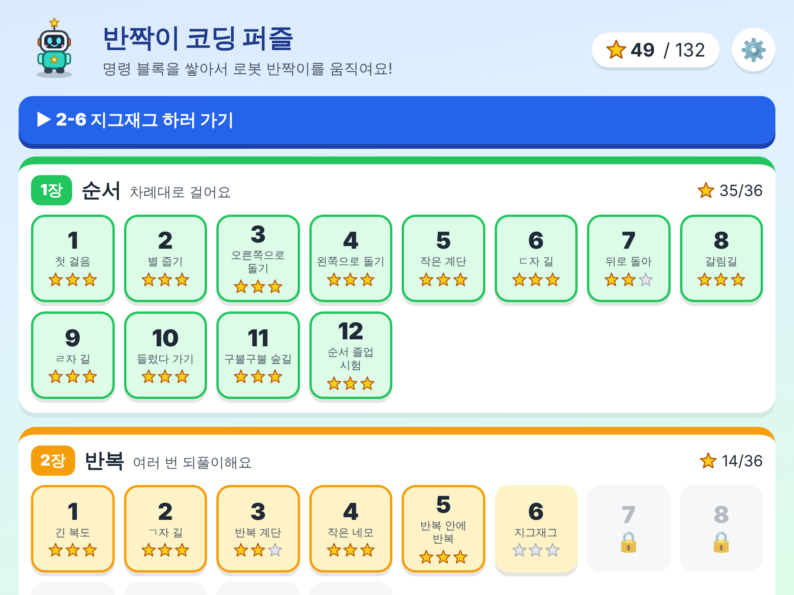
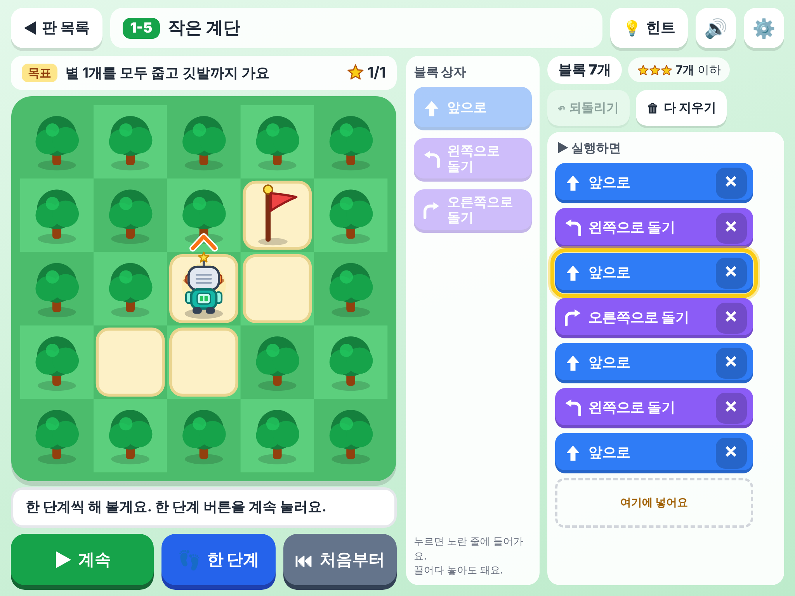
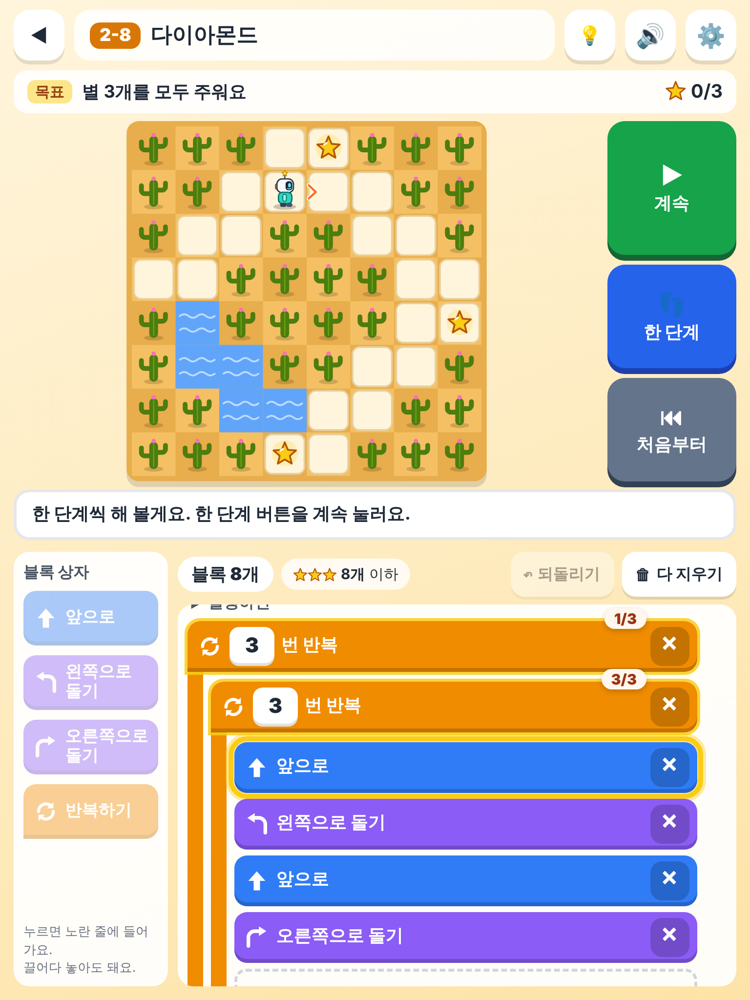
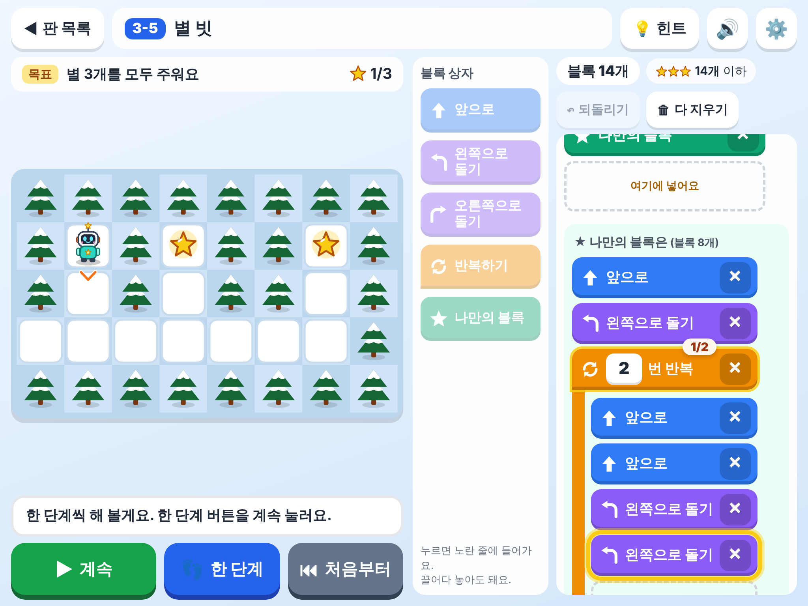
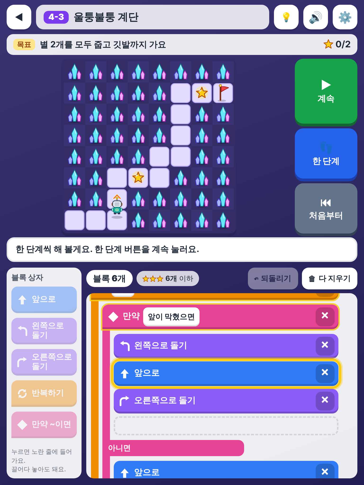

# 반짝이 코딩 퍼즐 🤖⭐

만 10세(초등 4학년 무렵) 아이가 아이패드에서 손가락으로 하는 **블록 코딩 퍼즐**입니다.
격자 지도 위의 로봇 **반짝이**에게 명령 블록을 순서대로 쌓아 주고 **[실행]** 을 누르면,
반짝이가 그대로 움직여서 별을 줍고 깃발까지 갑니다.

- 개념을 차례로 엽니다: **순서 → 반복(n번) → 나만의 블록(함수) → 조건(만약 ~이면 / 아니면)**
- 모두 **44판** (1장 12판, 2장 12판, 3장 8판, 4장 12판). 앞 판을 깨면 다음 판이 열립니다.
- 판마다 **최소 블록 수**를 기준으로 별 1~3개를 받습니다.
  - 별 3개: 기준 블록 수 이하 / 별 2개: 기준 + 2개(기준이 6개 이상이면 + 3개) 이하 / 별 1개: 깨기만 하면
- **한 단계씩 실행**, **처음부터**, **되돌리기**(방금 한 편집 취소), **다 지우기**
- 블록은 **탭**하면 노란 줄(넣을 곳)에 들어가고, **끌어다 놓기**로 원하는 곳에 넣거나 옮길 수 있습니다.
  쌓아 둔 블록을 프로그램 밖으로 끌어내거나 ✕를 누르면 빠집니다.
- 실행하는 동안 지금 도는 블록이 노랗게 빛나고, 반복 블록에는 `2/3`처럼 몇 번째인지,
  만약 블록에는 조건이 맞았는지(✓/✗)가 나옵니다. 벽에 부딪히면 그 블록이 빨갛게 빛납니다.
- 음성 안내(한국어, Web Speech)는 위쪽 🔊 버튼으로 끄고 켭니다. 설정(⚙️)에서 효과음, 실행 빠르기,
  모든 판 열기(어른용), 기록 지우기를 할 수 있습니다.
- 진행 기록(별, 짜던 프로그램, 설정)은 아이패드 브라우저의 `localStorage`에 저장됩니다.
- PWA: 홈 화면에 추가할 수 있고, https나 localhost로 열면 오프라인 캐시도 됩니다(아래 참고).
- 실행 중에는 바깥 인터넷으로 나가는 요청이 **하나도 없습니다** (CDN·웹 글꼴·외부 라이브러리 없음).
  로봇·배경·블록 아이콘은 모두 SVG로 직접 그렸습니다.

## 켜는 법

컴퓨터에서 이 폴더로 들어가 간단한 웹 서버를 켭니다.

```bash
cd coding-puzzle
```

```bash
python3 -m http.server 8000
```

그리고 **같은 와이파이**에 연결된 아이패드의 사파리에서 `http://<컴퓨터 IP 주소>:8000` 을 엽니다.
컴퓨터 IP 주소는 맥이라면 아래 명령으로 볼 수 있습니다.

```bash
ipconfig getifaddr en0
```

- 사파리 공유 버튼 → **홈 화면에 추가**를 누르면 앱처럼 전체 화면으로 열립니다.
- 소리와 음성은 화면을 한 번 누른 뒤부터 나옵니다(사파리 자동 재생 규칙). 음성이 안 나오면 아이패드
  설정 → 손쉬운 사용 → 읽기 및 말하기에서 한국어 목소리가 있는지 확인해 주세요.
- **오프라인 캐시 주의**: 서비스 워커는 https 주소나 `localhost`에서만 켜집니다. 집 와이파이에서
  `http://192.168.x.x:8000` 으로 열면 놀이는 잘 되지만, 인터넷이 끊긴 상태에서 다시 여는 오프라인 기능은
  동작하지 않습니다. 오프라인까지 쓰려면 https로 올려야 합니다(예: GitHub Pages).
- 주소 뒤에 `#2-5` 처럼 판 번호를 붙이면 그 판을 바로 엽니다(이미 열린 판만).

## 판 목록

"최소인지 확인" 칸:
- **너비 우선 탐색**: 1장은 블록 수 = 로봇이 하는 일의 수라서, 모든 경우를 따져 진짜 최소임을 확인했습니다.
- **자동 풀이기**: `tools/solver.mjs`가 그 판에서 쓸 수 있는 블록(반복 횟수 2~20, 고를 수 있는 조건 전부)으로
  기준보다 블록이 하나라도 적은 프로그램을 빠짐없이 찾아보고, 없다는 것을 확인했습니다.
  "(시험)"은 `npm test`에 들어 있고, "(따로)"는 시간이 오래 걸려 명령으로 따로 돌려 확인했습니다.
- **정답으로 달성만 확인**: 판마다 적어 둔 정답 프로그램을 해석기로 돌려 깨지고, 그 블록 수가 기준과 같음을
  확인했습니다(모든 판 공통). 프로그램 수가 너무 많아 '더 짧은 답이 없다'까지는 다 찾아보지 못했습니다.

### 1장 · 순서 — 차례대로 걸어요

| 판 | 이름 | 쓸 수 있는 블록 | 별 3개 기준 | 최소인지 확인 |
|---|---|---|---|---|
| 1-1 | 첫 걸음 | 앞으로, 왼쪽, 오른쪽 | 3개 | ✓ 너비 우선 탐색 |
| 1-2 | 별 줍기 | 앞으로, 왼쪽, 오른쪽 | 4개 | ✓ 너비 우선 탐색 |
| 1-3 | 오른쪽으로 돌기 | 앞으로, 왼쪽, 오른쪽 | 5개 | ✓ 너비 우선 탐색 |
| 1-4 | 왼쪽으로 돌기 | 앞으로, 왼쪽, 오른쪽 | 6개 | ✓ 너비 우선 탐색 |
| 1-5 | 작은 계단 | 앞으로, 왼쪽, 오른쪽 | 7개 | ✓ 너비 우선 탐색 |
| 1-6 | ㄷ자 길 | 앞으로, 왼쪽, 오른쪽 | 8개 | ✓ 너비 우선 탐색 |
| 1-7 | 뒤로 돌아 | 앞으로, 왼쪽, 오른쪽 | 8개 | ✓ 너비 우선 탐색 |
| 1-8 | 갈림길 | 앞으로, 왼쪽, 오른쪽 | 9개 | ✓ 너비 우선 탐색 |
| 1-9 | ㄹ자 길 | 앞으로, 왼쪽, 오른쪽 | 10개 | ✓ 너비 우선 탐색 |
| 1-10 | 들렀다 가기 | 앞으로, 왼쪽, 오른쪽 | 11개 | ✓ 너비 우선 탐색 |
| 1-11 | 구불구불 숲길 | 앞으로, 왼쪽, 오른쪽 | 12개 | ✓ 너비 우선 탐색 |
| 1-12 | 순서 졸업 시험 | 앞으로, 왼쪽, 오른쪽 | 14개 | ✓ 너비 우선 탐색 |

### 2장 · 반복 — 여러 번 되풀이해요

| 판 | 이름 | 쓸 수 있는 블록 | 별 3개 기준 | 최소인지 확인 |
|---|---|---|---|---|
| 2-1 | 긴 복도 | 앞으로, 왼쪽, 오른쪽, 반복 | 2개 | ✓ 자동 풀이기(시험) |
| 2-2 | ㄱ자 길 | 앞으로, 왼쪽, 오른쪽, 반복 | 5개 | ✓ 자동 풀이기(시험) |
| 2-3 | 반복 계단 | 앞으로, 왼쪽, 오른쪽, 반복 | 5개 | ✓ 자동 풀이기(시험) |
| 2-4 | 작은 네모 | 앞으로, 왼쪽, 오른쪽, 반복 | 4개 | ✓ 자동 풀이기(시험) |
| 2-5 | 반복 안에 반복 | 앞으로, 왼쪽, 오른쪽, 반복 | 4개 | ✓ 자동 풀이기(시험) |
| 2-6 | 지그재그 | 앞으로, 왼쪽, 오른쪽, 반복 | 7개 | ✓ 자동 풀이기(따로) |
| 2-7 | 긴 네모 | 앞으로, 왼쪽, 오른쪽, 반복 | 7개 | ✓ 자동 풀이기(따로) |
| 2-8 | 다이아몬드 | 앞으로, 왼쪽, 오른쪽, 반복 | 8개 | 정답으로 달성만 확인 |
| 2-9 | 십자 별 | 앞으로, 왼쪽, 오른쪽, 반복 | 8개 | 정답으로 달성만 확인 |
| 2-10 | 산 넘기 | 앞으로, 왼쪽, 오른쪽, 반복 | 10개 | 정답으로 달성만 확인 |
| 2-11 | 고리 두 개 | 앞으로, 왼쪽, 오른쪽, 반복 | 8개 | 정답으로 달성만 확인 |
| 2-12 | 달팽이 집 | 앞으로, 왼쪽, 오른쪽, 반복 | 12개 | 정답으로 달성만 확인 |

### 3장 · 나만의 블록 — 블록을 직접 만들어요

| 판 | 이름 | 쓸 수 있는 블록 | 별 3개 기준 | 최소인지 확인 |
|---|---|---|---|---|
| 3-1 | 계단 블록 | 앞으로, 왼쪽, 오른쪽, 나만의 블록 | 8개 | 정답으로 달성만 확인 |
| 3-2 | 세 칸씩 꺾기 | 앞으로, 왼쪽, 오른쪽, 나만의 블록 | 10개 | 정답으로 달성만 확인 |
| 3-3 | 쉬어 가는 계단 | 앞으로, 왼쪽, 오른쪽, 반복, 나만의 블록 | 10개 | 정답으로 달성만 확인 |
| 3-4 | 들쭉날쭉 계단 | 앞으로, 왼쪽, 오른쪽, 반복, 나만의 블록 | 11개 | 정답으로 달성만 확인 |
| 3-5 | 별 빗 | 앞으로, 왼쪽, 오른쪽, 반복, 나만의 블록 | 14개 | 정답으로 달성만 확인 |
| 3-6 | 세 갈래 계단 | 앞으로, 왼쪽, 오른쪽, 반복, 나만의 블록 | 14개 | 정답으로 달성만 확인 |
| 3-7 | 바위 세 개 | 앞으로, 왼쪽, 오른쪽, 반복, 나만의 블록 | 13개 | 정답으로 달성만 확인 |
| 3-8 | 위아래 빗 | 앞으로, 왼쪽, 오른쪽, 반복, 나만의 블록 | 19개 | 정답으로 달성만 확인 |

3장 판들은 "같은 모양이 **불규칙한 간격으로** 여러 번 나오는" 길이라, 반복만으로는 줄이기 어렵고
나만의 블록을 써야 기준에 닿도록 만들었습니다.

### 4장 · 조건 — 보고 판단해요

| 판 | 이름 | 쓸 수 있는 블록 (만약 블록의 조건) | 별 3개 기준 | 최소인지 확인 |
|---|---|---|---|---|
| 4-1 | 막히면 오른쪽 | 앞으로, 왼쪽, 오른쪽, 반복, 만약 (앞이 막혔으면) | 4개 | ✓ 자동 풀이기(시험) |
| 4-2 | 막히면 왼쪽 | 앞으로, 왼쪽, 오른쪽, 반복, 만약 (앞이 막혔으면) | 4개 | ✓ 자동 풀이기(시험) |
| 4-3 | 울퉁불퉁 계단 | 앞으로, 왼쪽, 오른쪽, 반복, 만약 (앞이 막혔으면) | 6개 | ✓ 자동 풀이기(시험) |
| 4-4 | 내려가는 계단 | … 만약 (앞이 막혔으면 / 앞이 뚫렸으면) | 6개 | ✓ 자동 풀이기(시험) |
| 4-5 | 왼쪽 길 찾기 | … 만약 (앞이 막혔으면 / 왼쪽이 뚫렸으면) | 4개 | ✓ 자동 풀이기(시험) |
| 4-6 | 오른쪽 길 찾기 | … 만약 (앞이 막혔으면 / 왼쪽이 뚫렸으면 / 오른쪽이 뚫렸으면) | 4개 | ✓ 자동 풀이기(시험) |
| 4-7 | 꼬불꼬불 굴 | … 만약 (앞이 막혔으면 / 왼쪽이 뚫렸으면 / 오른쪽이 뚫렸으면) | 6개 | ✓ 자동 풀이기(시험) |
| 4-8 | 막다른 길 미로 | … 만약 (앞이 막혔으면 / 왼쪽이 뚫렸으면 / 오른쪽이 뚫렸으면) | 6개 | ✓ 자동 풀이기(시험) |
| 4-9 | 들쭉날쭉 산 | … 만약 (앞이 막혔으면 / 왼쪽이 뚫렸으면) | 6개 | ✓ 자동 풀이기(시험) |
| 4-10 | 어느 손으로? | … 만약 (앞이 막혔으면 / 왼쪽이 뚫렸으면 / 오른쪽이 뚫렸으면) | 5개 | ✓ 자동 풀이기(시험) |
| 4-11 | 빗 탐험대 | … 만약 (앞이 막혔으면 / 왼쪽이 뚫렸으면 / 오른쪽이 뚫렸으면) | 6개 | ✓ 자동 풀이기(시험) |
| 4-12 | 마지막 미로 | … 만약 (앞이 막혔으면 / 앞이 뚫렸으면 / 왼쪽이 뚫렸으면 / 오른쪽이 뚫렸으면) | 6개 | ✓ 자동 풀이기(시험) |

4장 뒤쪽(4-10~4-12)의 별 3개 기준은 자동 풀이기가 찾은 "만약 블록 하나로 왼손 짚기"
(`앞이 막혔으면 오른쪽으로, 아니면 앞으로 가서 왼쪽 보기`)에 맞춰져 있습니다. 4-10 힌트에서 이 비밀을 알려 줍니다.
만약 블록 두 개로 짠 보통의 벽 짚기 프로그램은 별 2개를 받습니다.

## 시험

시험 도구는 이 폴더의 `package.json` devDependencies에만 있습니다(앱 실행에는 필요 없음).
Node.js 20 이상이면 단위 시험은 아무것도 설치하지 않고 돌아갑니다.

```bash
npm test
```

- `tests/engine.test.mjs` — 명령 해석기: 앞으로·돌기·벽에 부딪힘·별 줍기·성공 판정, 반복(안에 반복),
  나만의 블록(반복 안에서 부르기, 자기 자신을 부를 때 멈추기), 조건 네 가지와 아니면 칸, 너무 오래 걸릴 때 멈추기,
  블록 세기와 별 매기기, 짧은 글 형식 읽기/쓰기
- `tests/levels.test.mjs` — **모든 판**: 지도 모양 확인, 적어 둔 정답을 해석기로 돌려 깨지는지, 정답 블록 수가
  별 3개 기준과 같은지(= 별 3개를 실제로 받을 수 있는지), 그 판에서 쓸 수 있는 블록만 썼는지,
  1장은 너비 우선 탐색으로 최소 확인, 17개 판은 자동 풀이기로 더 짧은 답이 없는지 확인 (약 1분)
- `tests/app-files.test.mjs` — 바깥 인터넷 주소가 파일 어디에도 없는지, 오프라인 캐시 목록이 빠짐없는지

아이패드 크기 브라우저 시험(Playwright, 크로미움)은 따로 돌립니다.

```bash
npm install
```

```bash
npx playwright install chromium
```

```bash
npm run test:e2e
```

- `tests/e2e.test.mjs` — 아이패드 가로(1024×768)·세로(768×1024)에서 진짜 터치 이벤트로 1-1을 깹니다:
  탭으로 넣기, 끌어다 놓기로 넣기, 끌어서 밖으로 빼기, 되돌리기, 한 단계 실행과 처음부터, 실행 → 성공 창과 별 3개 →
  기록 저장 → 다음 판. 그동안 바깥으로 나가는 요청·오류가 없는지, 버튼이 화면 안에 있고 44px 이상인지도 봅니다.
  반복 블록(횟수 바꾸기, 다시 열어도 남아 있기), 나만의 블록(안에 ★을 못 넣는지), 만약 블록으로 판 깨기도 시험합니다.

그 밖의 도구:

```bash
node tools/solver.mjs 2-8 3-5
```

판마다 기준보다 짧은 답이 있는지 찾아봅니다(`LIMIT_MS`, `MAX_STMT` 환경 변수로 시간·깊이 조절).
`node tools/trace.mjs`는 새 판을 만들 때 경로로부터 지도를 그려 주고,
`npm run screenshots`는 `docs/` 스크린샷을, `npm run icons`는 홈 화면 아이콘 PNG를 다시 만듭니다.

## 스크린샷 (`docs/`)

| | |
|---|---|
|  |  |
|  |  |
|  |  |

## 폴더 구조

```
coding-puzzle/
├── index.html          화면 뼈대
├── manifest.json, sw.js  홈 화면 앱 정보, 오프라인 캐시
├── css/app.css         화면 꾸밈 (가로·세로 배치)
├── js/
│   ├── engine.js       명령 해석기 (화면과 상관없는 순수 계산, Node에서도 시험)
│   ├── levels.js       판 44개와 장 소개, 판마다 정답 프로그램
│   ├── editor.js       블록 편집기 (탭·끌어다 놓기, 되돌리기)
│   ├── board.js        판 그리기, 로봇 움직임
│   ├── art.js          반짝이·나무·별·깃발·블록 아이콘 SVG
│   ├── sound.js        효과음(WebAudio)과 음성 안내(Web Speech, ko-KR)
│   ├── store.js        기록 저장(localStorage)
│   └── app.js          화면 바꾸기, 실행·한 단계·처음부터, 별 매기기, 안내 창
├── icons/              앱 아이콘 (SVG와 PNG)
├── tests/              시험
├── tools/              자동 풀이기, 지도 그리기 도우미, 스크린샷·아이콘 만들기
└── docs/               스크린샷
```

새 판을 넣을 때는 `js/levels.js`에 지도와 정답(`solution`)·기준(`best`)을 적고 `npm test`를 돌리면 됩니다.
앱 파일을 고쳐서 다시 올릴 때는 `sw.js`의 `CACHE` 버전 숫자를 하나 올려 주세요.

## 남은 일

- 진짜 아이패드 사파리에서 손으로 해 보기 (시험은 크로미움 브라우저로 아이패드 크기·터치를 흉내 낸 것)
- 3장과 2장 뒤쪽 판들은 프로그램 수가 너무 많아 "더 짧은 답이 없다"까지는 다 찾아보지 못함 (정답으로 기준 달성만 확인)
- 오프라인 캐시를 쓰려면 https로 올리기
- 루트 첫 화면(앱 고르기)에서 이 앱으로 가는 링크 연결
