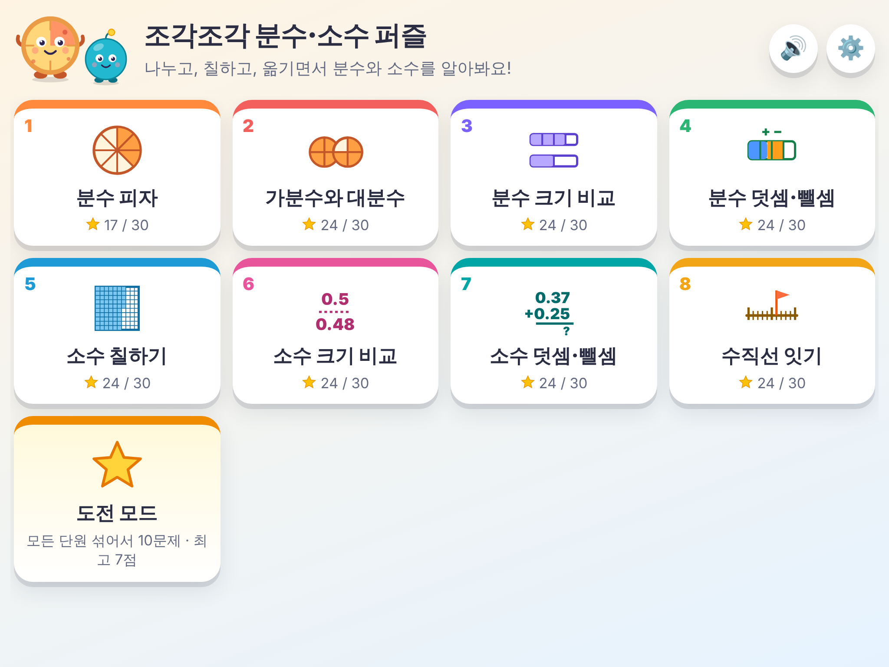
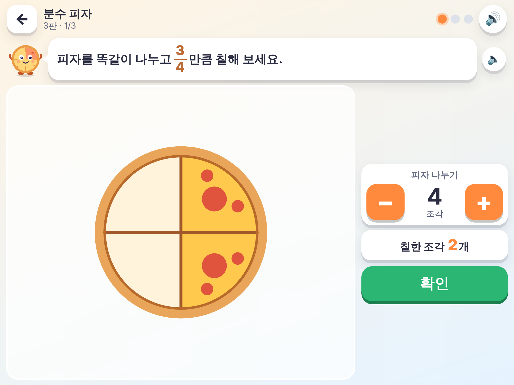
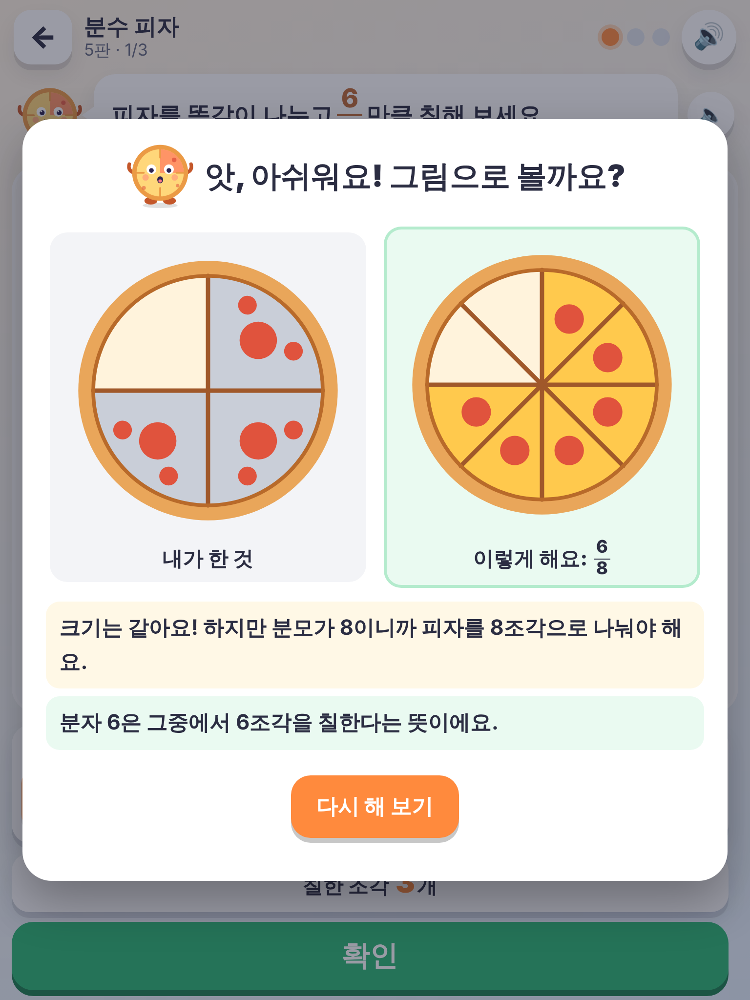
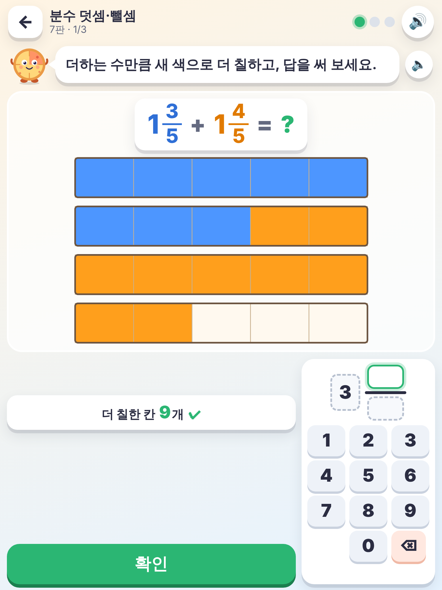
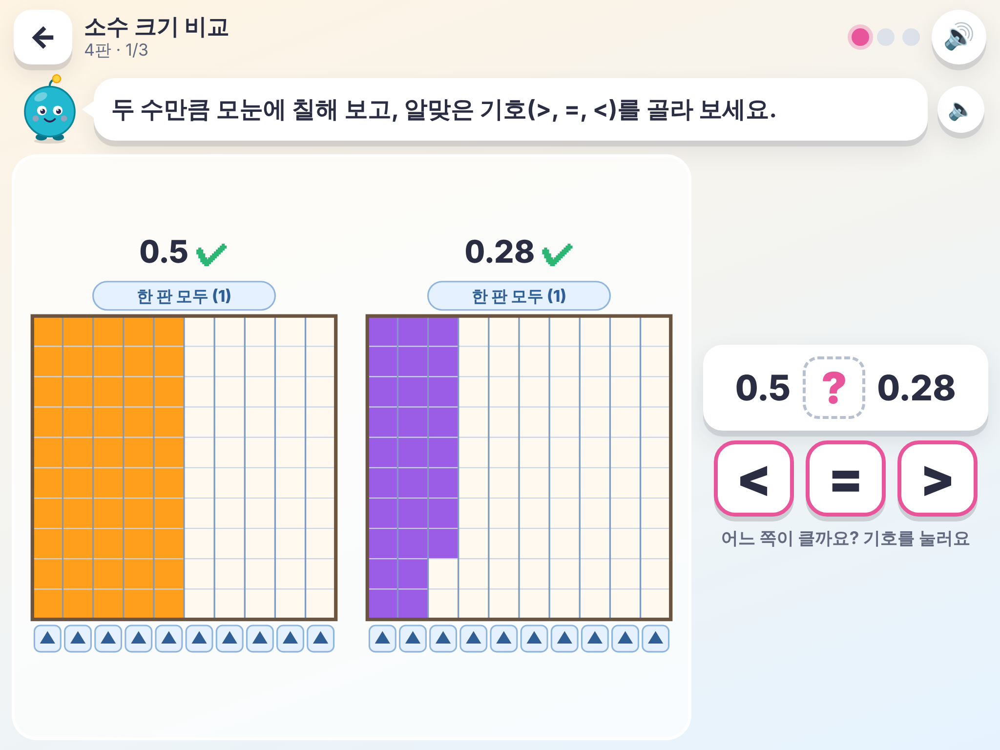
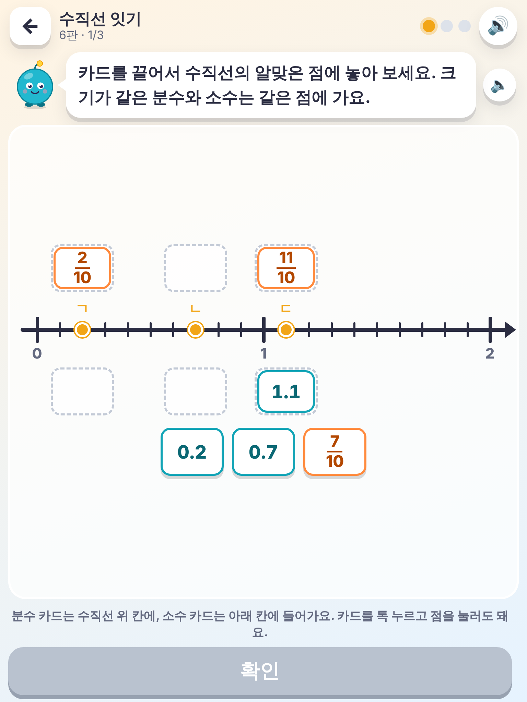
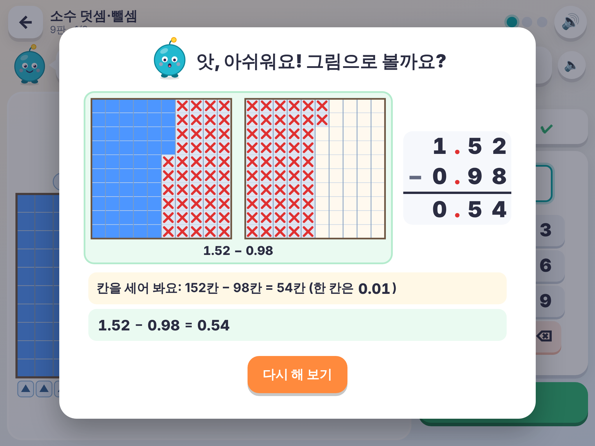

# 조각조각 분수·소수 퍼즐 🍕

만 10세(초등 4학년 무렵) 아이가 **아이패드에서 손가락으로** 하는 분수·소수 놀이입니다.
문제를 글로만 내지 않고, 피자를 **나누고**, 막대와 모눈을 **칠하고**, 수직선에서 깃발과 카드를 **옮기면서** 답을 만듭니다.
틀리면 "내가 한 것"과 "바르게 한 것"을 그림으로 나란히 보여 주고, 왜 틀렸는지 짧게 설명해 줍니다.

- 빌드 없이 도는 정적 HTML/CSS/JS(ES 모듈) 한 폴더. 외부 라이브러리·글꼴·CDN을 쓰지 않아 **실행 중에 인터넷 요청이 하나도 없습니다.**
- PWA: 홈 화면에 추가할 수 있고, 서비스 워커가 파일을 캐시합니다(아래 '오프라인' 참고).
- 가로·세로 모두 됩니다. 글자는 크게, 누르는 곳은 넉넉하게 만들었습니다.
- 음성 안내(Web Speech, ko-KR)가 문제를 읽어 줍니다. 위쪽 🔊 단추로 언제든 끌 수 있습니다.
- 별·기록은 아이패드 브라우저(localStorage)에 저장됩니다.
- 캐릭터 **조각이**(네 조각 파이 몸통의 분수 친구)와 **콕이**(소수점처럼 동그란 소수 친구), 아이콘, 피자·모눈 그림은 모두 SVG/CSS로 새로 그렸습니다.

| 첫 화면 | 피자 나누고 칠하기 | 틀렸을 때 그림 설명 |
|---|---|---|
|  |  |  |

| 분수 덧셈 (세로) | 소수 크기 비교 | 수직선 카드 (세로) | 소수 뺄셈 설명 |
|---|---|---|---|
|  |  |  |  |

## 켜는 법 (같은 와이파이의 아이패드에서)

1. 컴퓨터(맥 등)에서 이 폴더로 가서 웹 서버를 켭니다.

   ```bash
   cd fraction-puzzle
   ```

   ```bash
   python3 -m http.server 8000
   ```

2. 컴퓨터의 와이파이 주소를 알아봅니다. 맥이라면:

   ```bash
   ipconfig getifaddr en0
   ```

   (예: `192.168.0.12`)
3. 같은 와이파이에 연결된 아이패드의 **사파리**에서 `http://192.168.0.12:8000/` 처럼 접속합니다.
4. 사파리의 공유 단추 → **홈 화면에 추가**를 누르면 앱처럼 전체 화면으로 열립니다.

> **오프라인 참고:** 브라우저 보안 규칙 때문에 서비스 워커(오프라인 캐시)는 `https://` 주소나 `localhost`에서만 켜집니다.
> 위처럼 `http://192.168.…` 로 열면 놀이는 잘 되지만, 컴퓨터의 서버가 꺼져 있으면 다시 열 수 없습니다.
> 인터넷 없이 완전히 쓰려면 나중에 HTTPS 주소(예: GitHub Pages)에 올리면 됩니다. 컴퓨터에서 `http://localhost:8000/`로 열면 오프라인 캐시가 동작합니다(자동 시험으로 확인함).
>
> **음성이 안 나오면:** 아이패드 설정 → 손쉬운 사용 → 읽기 및 말하기 → 음성에서 한국어 음성을 받아 주세요. 앱의 ⚙️ 설정 화면에서 한국어 목소리가 있는지 볼 수 있습니다. 소리는 첫 터치 뒤부터 납니다.

## 놀이

- 첫 화면에서 단원 8개 중 하나를 고르고, **판**(단원마다 10판)을 고릅니다. 한 판은 문제 3개입니다.
- 한 번도 안 틀리면 별 3개, 1~2번 다시 하면 별 2개, 그보다 많으면 별 1개. 판을 끝내면 다음 판이 열립니다.
- 틀리면 그림 설명을 보고 **다시 해 보기**로 같은 문제를 이어서 고칩니다(칠한 것은 그대로 남아 있음).
- **도전 모드**: 모든 단원에서 섞어서 10문제, 하트 3개. 틀리면 하트가 하나 줄고 설명을 본 뒤 다음 문제로 갑니다. 최고 점수가 저장됩니다.

| 조작 | 하는 법 |
|---|---|
| 피자 나누기 | −/+ 단추로 몇 조각으로 나눌지 정함 (1~12조각) |
| 칠하기 | 칸(조각)을 톡 누르거나 손가락으로 문지르기. 칠한 칸을 다시 누르면 지워짐 |
| 모눈 한 줄·한 판 | 모눈 아래 ▲ 단추 = 한 줄(0.1), 위 '한 판 모두' = 1 |
| 빼기 | 칠해 둔 칸을 눌러 ✕ 표시 |
| 답 쓰기 | 큰 숫자판. 분수는 [자연수][분자/분모] 칸을 눌러 고른 뒤 숫자를 누름 |
| 수직선 깃발 | 깃발을 끌거나 수직선을 톡 누르면 가장 가까운 눈금으로 옮겨짐 |
| 수직선 카드 | 카드를 점까지 끌어다 놓기(분수는 위 칸, 소수는 아래 칸). 카드를 톡 누르고 점을 눌러도 됨 |

## 교과 범위 (2022 개정 교육과정, 초등 3~4학년군 수학)

성취기준 번호와 문구는 비상교육 비바샘의 [「초등학교 3~4학년군 수학 성취기준」](https://dn22.vivasam.com/VS/ES/MAT/106395/promo_library/ref_common/%EC%B4%88%EB%93%B1%ED%95%99%EA%B5%90%203~4%ED%95%99%EB%85%84%EA%B5%B0%20%EC%88%98%ED%95%99%20%EC%84%B1%EC%B7%A8%EA%B8%B0%EC%A4%80.pdf) 자료(수학 4-1 교사용 지도서, 'Ⅰ. 2022 개정 수학과 교육과정' 부분)에서 옮겼습니다.
성취기준은 **3~4학년군** 단위라서, 각 내용이 3학년과 4학년 중 언제 나오는지는 이 자료만으로 알 수 없어 **'확인 필요'**로 적었습니다.

| 앱 단원 (판 수) | 다루는 것 | 성취기준 | 확인 |
|---|---|---|---|
| 1. 분수 피자 (10판) | 피자를 똑같이 나누기(분모 2~12), 단위분수·진분수 만들기, "먹고 남은 양" | [4수01-09] 양의 등분할을 통하여 분수의 필요성을 인식하고, 분수를 이해하고 읽고 쓸 수 있다. | 문구 확인함 · 학년 배치(3학년 내용일 수 있음) **확인 필요** |
| 2. 가분수와 대분수 (10판) | 피자 여러 판으로 가분수·대분수 만들기, 서로 바꿔 쓰기, 자연수가 되는 가분수(8/4=2) (분모 2~8) | [4수01-10] 단위분수, 진분수, 가분수, 대분수를 알고, 그 관계를 이해한다. | 문구 확인함 · 학년 배치 **확인 필요** |
| 3. 분수 크기 비교 (10판) | 분모가 같은 분수, 단위분수끼리, 가분수·대분수끼리, 가분수와 대분수(같을 때 =) | [4수01-11] 분모가 같은 분수끼리, 단위분수끼리 크기를 비교하고 그 방법을 설명할 수 있다. | 문구 확인함 |
| 4. 분수 덧셈·뺄셈 (10판) | 분모가 같은 진분수·대분수의 덧셈·뺄셈, 받아올림·받아내림, (자연수)−(분수), 답 4 미만 | [4수01-15] 분모가 같은 분수의 덧셈과 뺄셈의 계산 원리를 이해하고 그 계산을 할 수 있다. | 문구 확인함 · 받아올림/받아내림이 있는 대분수 계산의 교과서 범위 **확인 필요** |
| 5. 소수 칠하기 (10판) | 10칸 막대로 소수 한 자리, 100칸 모눈으로 소수 두 자리, 분모 10·100인 분수 ↔ 소수, 0.07과 0.7 같은 자리값 | [4수01-12] 분모가 10인 진분수와 연결하여 소수 한 자리 수를 이해하고 읽고 쓸 수 있다. / [4수01-13] 자릿값의 원리를 바탕으로 소수 두 자리 수와 소수 세 자리 수를 이해하고 읽고 쓸 수 있다. | 문구 확인함 · **소수 세 자리 수는 아직 안 다룸** |
| 6. 소수 크기 비교 (10판) | 0.5와 0.48(자릿수 함정), 0.3 = 0.30, 0.09와 0.1, 1보다 큰 소수 | [4수01-14] 소수의 크기를 비교하고 그 방법을 설명할 수 있다. | 문구 확인함 |
| 7. 소수 덧셈·뺄셈 (10판) | 소수 한·두 자리 덧셈·뺄셈, 받아올림·받아내림, 자릿수가 다른 수(0.5+0.27), 답 3 미만 | [4수01-16] 소수 두 자리 수의 범위에서 소수의 덧셈과 뺄셈의 계산 원리를 이해하고 그 계산을 할 수 있다. | 문구 확인함 (해설: "계산 원리를 이해할 수 있는 수준에서 간단히") |
| 8. 수직선 잇기 (10판) | 수직선에서 분수·소수 자리 찾기(0~2, 0.01 눈금 확대), 같은 점에 분수 카드와 소수 카드 놓기 | [4수01-12]·[4수01-13]과 이어지는 활동 | 수직선 활동이 성취기준 문구에 직접 나오지 않음 · **확인 필요** |
| 도전 모드 | 8단원을 섞어서 10문제 | — | — |

크기 비교의 `=` 기호는 [4수02-03] "등호를 사용하여 크기가 같은 두 양의 관계를 식으로 나타낼 수 있다"와도 이어집니다(**확인 필요**).

## 정확한 계산

분수와 소수는 모두 **분자·분모가 정수인 유리수**로 계산합니다(`js/rational.js`). 소수 답 "0.3"은 `3/10`으로 읽어서 비교하므로 `0.1 + 0.2 = 0.30000000000000004` 같은 부동소수 오차가 생기지 않습니다. 정답 판정(`js/judge.js`)은 값이 같은지와 함께 아이가 자주 하는 실수를 알아봅니다.

- 피자: 크기는 같지만 분모가 다르게 나눈 경우(3/4을 8조각에 6조각)
- 가분수·대분수: 모양이 틀린 경우(1 7/4), 분모를 바꾼 경우(22/8)
- 덧셈: 분모끼리 더한 경우(2/7 + 3/7 → 5/14), 받아올림을 안 한 경우(2 7/5)
- 뺄셈: 받아내림 없이 거꾸로 뺀 경우(3 1/5 − 1 3/5 → 2 2/5)
- 소수: 소수점을 맞추지 않고 더한 경우(0.5 + 0.27 → 0.32), 0.4를 4칸만 칠한 경우

## 시험

```bash
cd fraction-puzzle
```

단위 시험(설치할 것 없음, Node 22):

```bash
npm test
```

아이패드 크기 터치 흐름 시험(처음 한 번 Playwright 설치):

```bash
npm install
```

```bash
npx playwright install chromium
```

```bash
npm run test:e2e
```

스크린샷(`docs/`)·아이콘 다시 만들기:

```bash
npm run screenshots
```

```bash
npm run icons
```

**결과 (2026-10-30)**

- 단위 시험 211개 모두 통과 (`tests/unit/`)
  - 8단원 × 10판마다 문제 180개씩, 모두 1만 4천 개 넘게 만들어서: 범위 안인지, 모범 답이 정답인지, 틀린 답마다 설명 글이 나오는지
  - 판마다 일부 문제는 가능한 답을 모두 대 보며 **정답이 하나뿐인지** 확인 (칠하는 칸 수, 피자 조각 수, 기호, 깃발 눈금, 카드 놓는 방법, 대분수·가분수로 쓰는 답. 7/5와 1 2/5처럼 모양만 다른 답은 같은 값인지)
  - 유리수 계산(0.00~20.00 소수 글자 되돌리기, 무작위 분수 1000쌍), 한국어 읽기·조사, 자주 하는 실수 판정
- 터치 흐름 시험 8개 모두 통과 (`tests/e2e/`, Chromium 터치 흉내, 1024×768 가로·768×1024 세로)
  - 피자를 −/+로 나누고 톡톡 칠해서 '분수 피자' 1판(문제 3개)을 맞힘 → 별 3개 저장 → 다음 판 열림
  - 일부러 틀림 → 그림 설명(내가 한 것/바른 그림) → 다시 해 보기 → 손가락으로 문질러 칠해서 맞힘 → 별 2개
  - 8단원의 1판과 마지막 판(모두 48문제)을 가로·세로에서 칠하기·✕·숫자판·깃발 끌기·카드 끌기로 모두 맞힘
  - 도전 모드 하트 3개, 바깥 인터넷 요청 0개, 오류 0개, `localhost`에서 서비스 워커로 오프라인 다시 열기

## 폴더

```
fraction-puzzle/
  index.html            한 페이지 앱
  manifest.webmanifest  홈 화면 앱 정보
  sw.js                 오프라인 캐시 (파일을 고치면 CACHE 버전을 올려 주세요)
  css/app.css
  js/
    rational.js         정수 분자·분모 유리수 계산
    num.js              분수·소수 모양, 한국어 읽기·조사
    problems.js         단원·판·문제 만들기 (DOM 없음)
    judge.js            정답 판정·모범 답 (DOM 없음)
    text.js             문제 문장·틀렸을 때 설명 글
    board.js            피자·막대·모눈 칠하는 판 (SVG, 터치)
    numberline.js       수직선 깃발·카드
    keypad.js           숫자판
    puzzles.js          문제 종류별 화면
    explain-view.js     설명 그림 (세로셈 포함)
    art.js              조각이·콕이·아이콘 그림
    audio.js            효과음·음성 안내
    store.js            별·설정 저장
    app.js              화면 흐름
  icons/                앱 아이콘 (icon.svg → PNG)
  tests/unit/           단위 시험 (node:test)
  tests/e2e/            Playwright 터치 시험
  tools/                아이콘·스크린샷 만드는 도구
  docs/                 아이패드 크기 스크린샷
```

## 남은 일

- 진짜 아이패드 사파리에서 손으로 해 보기: 자동 시험은 Chromium의 터치 흉내로만 했습니다. 음성·효과음도 기기에서 들어 봐야 합니다.
- 교과 범위의 '확인 필요' 항목(학년·학기 배치, 대분수 받아올림 범위, 수직선 활동)을 교과서로 확인하기
- 소수 세 자리 수([4수01-13]의 일부) 판 추가
- `http://` 주소로 열 때는 오프라인 캐시가 안 되므로, HTTPS로 올릴지 정하기
- 저장소 첫 화면(앱 고르기)에 이 앱 연결하기
