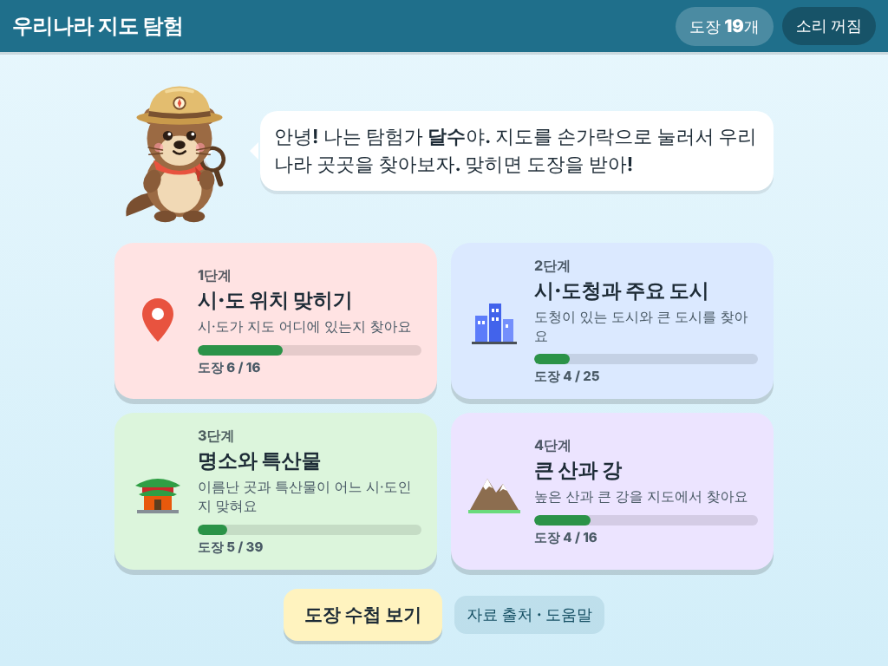
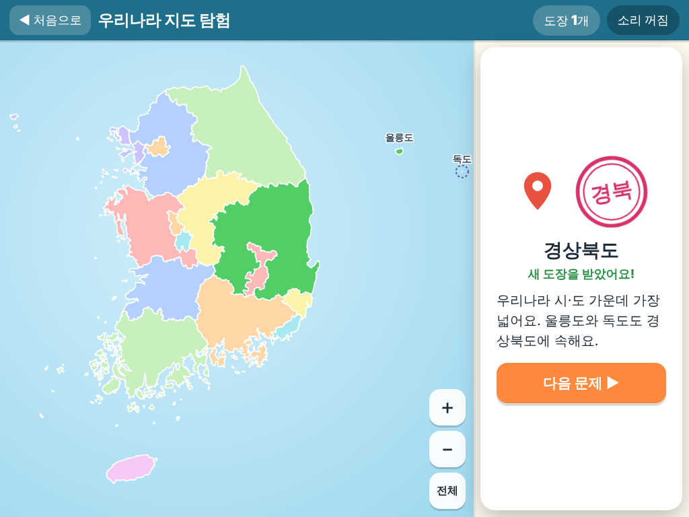
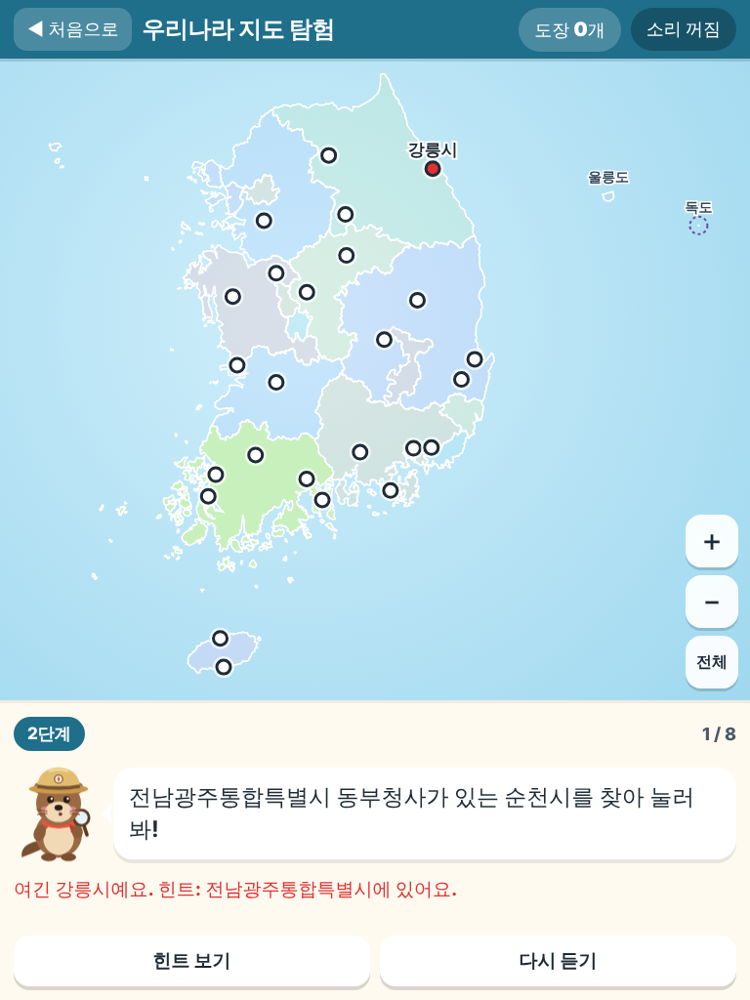
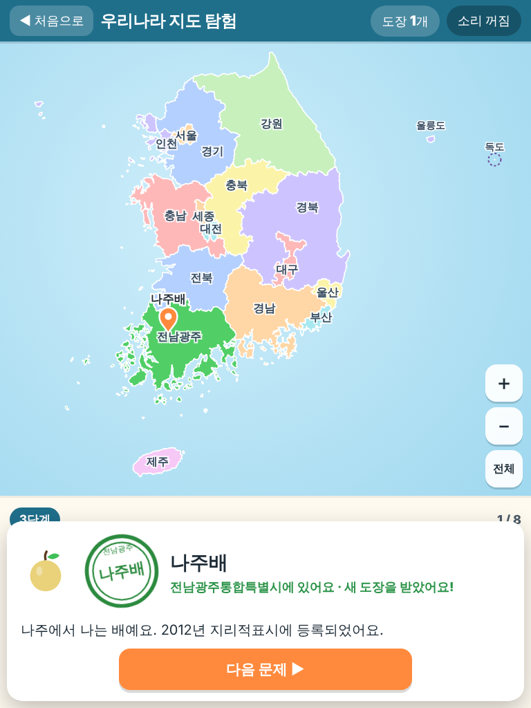
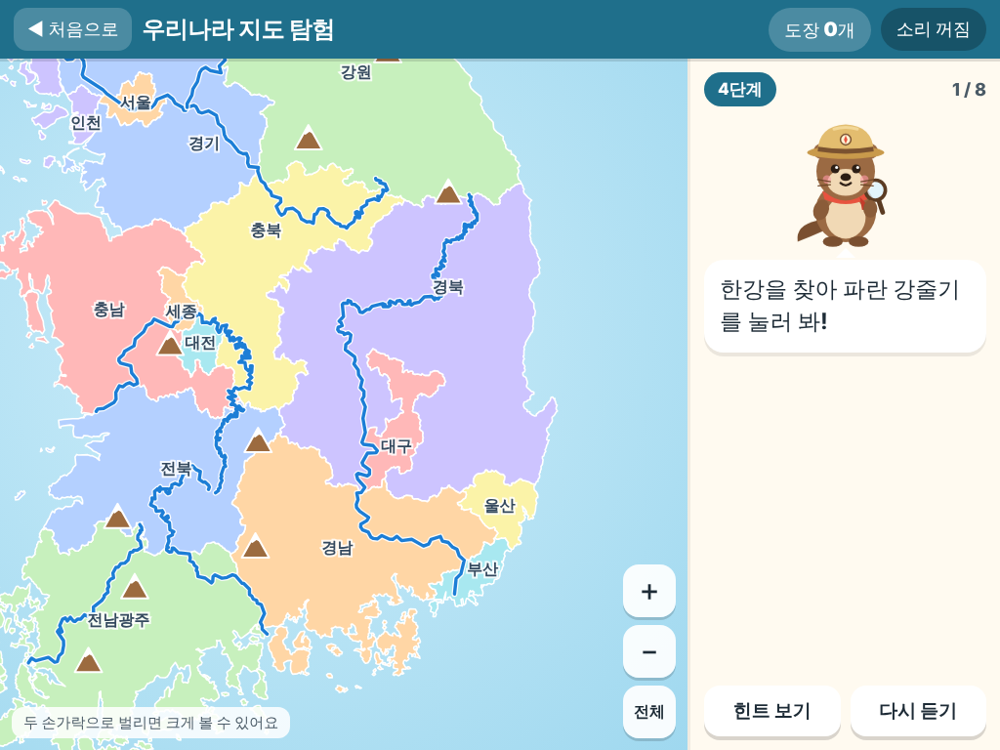
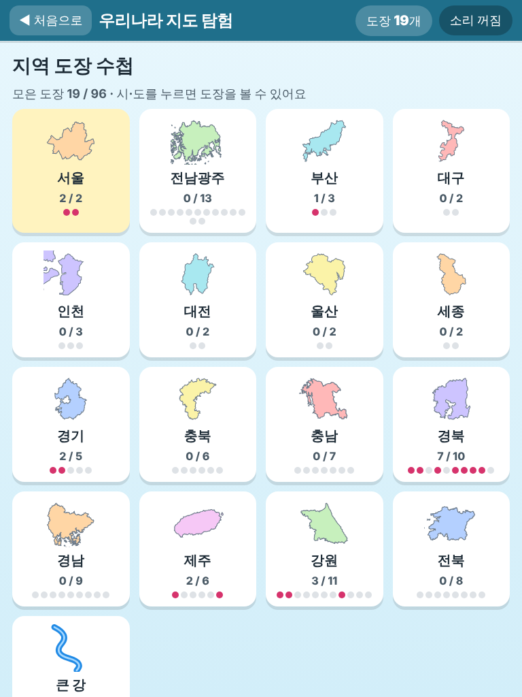
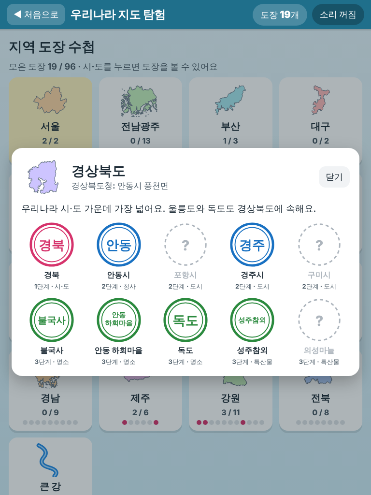

# 우리나라 지도 탐험

만 10세(초등 4학년 무렵) 아이가 아이패드에서 손가락으로 하는 지도 놀이입니다.
안내 캐릭터 **탐험가 달수**(모자 쓴 수달)와 함께 지도를 눌러 우리나라 곳곳을 찾고, 맞힐 때마다 도장을 모읍니다.



## 놀이

| 단계 | 하는 일 | 맞히는 방법 |
| --- | --- | --- |
| ① 시·도 위치 맞히기 | "경상남도를 찾아 눌러 봐!" | 이름표 없는 지도에서 그 시·도를 누름 (16곳) |
| ② 시·도청과 주요 도시 | "경상북도청이 있는 도시는 어디일까?" / "포항시를 찾아 눌러 봐!" | 하얀 동그라미(도시)를 누름 (25곳) |
| ③ 명소와 특산물 | "불국사는 어느 시·도에 있을까?" / "특산물 '성주참외'는 어느 시·도에서 날까?" | 그 시·도를 누르면 정확한 자리에 핀이 꽂힘 (명소 23, 특산물 16) |
| ④ 큰 산과 강 | "지리산을 찾아 눌러 봐!" / "낙동강을 찾아 파란 강줄기를 눌러 봐!" | 갈색 세모(산)나 파란 줄(강)을 누름 (산 11, 강 5) |

- 한 판에 8문제. 아직 도장을 못 받은 문제가 먼저 나옵니다.
- 틀리면 누른 곳의 이름을 알려 주고, 두 번 틀리면 힌트(이웃한 시·도, 어느 시·도에 있는지 등)와 함께 답이 있는 시·도만 밝게 보여 주고, 세 번 틀리면 답이 반짝입니다. '힌트 보기' 단추로도 도움을 받을 수 있습니다.
- 두 손가락으로 벌리면 확대, 한 손가락으로 끌면 이동, 오른쪽 아래 `＋ － 전체` 단추도 있습니다. 독도·울릉도처럼 아주 작은 섬은 이름표를 늘 붙여 두었고, 근처만 눌러도 맞게 칩니다.
- **지역 도장 수첩**: 시·도마다 받을 수 있는 도장(시·도, 도시, 명소, 특산물, 산)을 모아 보여 주고, 강 도장은 따로 한 쪽에 모읍니다. 모두 96개.
- 음성 안내(Web Speech, ko-KR)는 위쪽 `소리 켜짐/꺼짐` 단추로 끌 수 있습니다. 효과음도 함께 꺼집니다.
- 진행(도장, 소리 설정)은 `localStorage`의 `korea-map:v1`에 저장됩니다. '자료 출처 · 도움말' 화면 맨 아래에서 도장을 모두 지울 수 있습니다.
- 캐릭터와 그림(아이콘, 도장)은 모두 이 앱을 위해 SVG로 새로 그렸습니다. 외부 글꼴·라이브러리·CDN을 쓰지 않습니다.

| 1단계 정답 (가로) | 2단계 힌트 (세로) | 3단계 정답 (세로) |
| --- | --- | --- |
|  |  |  |

| 4단계 확대 (가로) | 도장 수첩 (세로) | 수첩 한 쪽 (세로) |
| --- | --- | --- |
|  |  |  |

## 켜는 법

빌드가 필요 없는 정적 사이트입니다. 컴퓨터에서 이 폴더를 띄우고 같은 와이파이의 아이패드 사파리로 접속합니다.

```bash
cd korea-map
```

```bash
python3 -m http.server 8000
```

1. 컴퓨터의 내부 IP 주소를 확인합니다. (맥: `시스템 설정 → Wi-Fi → 세부사항`, 또는 터미널에서 `ipconfig getifaddr en0`)
2. 아이패드 사파리에서 `http://<컴퓨터 IP>:8000` 을 엽니다. (예: `http://192.168.0.12:8000`)
3. 공유 단추 → **홈 화면에 추가** 하면 앱처럼 전체 화면으로 열립니다.

참고

- 앱은 실행 중에 바깥 인터넷에 요청을 하나도 보내지 않습니다(시험으로 확인). 집 인터넷이 끊겨도 컴퓨터 서버와 와이파이만 있으면 됩니다.
- 서버 없이 아이패드 혼자 오프라인으로 쓰는 기능(서비스워커 저장)은 브라우저 규칙상 **https 주소나 localhost** 에서만 켜집니다. `http://192.168…` 로 접속하면 오프라인 저장은 되지 않습니다. 완전한 오프라인이 필요하면 https 로 올린 주소에서 한 번 열어 두세요. 파일을 고쳐서 다시 올릴 때는 `sw.js` 의 `CACHE` 버전 숫자를 올려 주세요.
- 목소리가 안 나오면 아이패드 `설정 → 손쉬운 사용 → 읽기 및 말하기 → 음성` 에서 한국어 음성을 받아 두세요. 첫 화면을 한 번 누른 뒤부터 소리가 납니다(사파리 자동 재생 규칙).

## 시험

시험 도구(Playwright 등)는 이 폴더의 `package.json` devDependencies 에만 있습니다.

```bash
cd korea-map && npm install
```

```bash
npm test
```

- `npm run test:unit` — Node 내장 시험(`node --test`). 브라우저 없이 돕니다.
  - `tests/data.test.mjs` 데이터 무결성: 16개 시·도가 경계·이름·종류·소재지를 모두 가지는지, 2026년 이름(특별자치도, 전남광주통합특별시)인지, 경계가 닫힌 다각형인지, 독도·울릉도·군위군이 바른 시·도에 있는지, **도시 25·명소 23·특산물 16·산 11곳이 모두 자기 시·도 경계 안에 찍히는지**(단순화로 해안선 밖에 살짝 나간 점은 1.5km까지, 그것도 가장 가까운 시·도가 맞을 때만 허용), 강 5개가 적어 둔 시·도를 실제로 지나는지, 항목마다 출처가 있는지, 특산물 이름이 지리적표시 등록 목록에 있는지.
  - `tests/judge.test.mjs` 맞히기 판정: 시·도 찾기(안쪽/바닷가/독도), 점·선 가까운 것 찾기, 문제 종류별 판정, 틀린 횟수별 도움 단계, 그리고 네 단계 **모든 문제**를 정답 자리로 눌렀을 때 맞음으로 나오는지.
  - `tests/quiz.test.mjs` 문제 만들기·조사(을/를 등)·이웃 시·도 계산·한 판 고르기·도장 수첩 칸 수·저장(localStorage 망가짐·막힘 대비).
- `npm run test:e2e` — Playwright(Chromium, 터치 켬)로 **아이패드 가로 1024×768, 세로 768×1024** 에서:
  - 1단계에서 시·도 하나를 손가락으로 눌러 맞히고 도장을 받는 흐름
  - 틀렸을 때 이름 알려 주기 → 힌트 → 답 반짝임, 바다를 누르면 틀린 것으로 치지 않기
  - 두 손가락 벌리기(실제 터치 점 두 개)로 확대한 뒤에도 맞히기
  - 2단계에서 도시 점을 조금 빗나가게 눌러도 맞히기
  - 새로고침 뒤 도장 유지, 도장 수첩에 보이기
  - 실행 중 바깥 인터넷 요청 0건

이 저장소에서 마지막으로 돌린 결과: 단위 시험 35개 통과, Playwright 12개(두 크기 × 6개) 통과.

## 폴더 구조

```
korea-map/
  index.html, css/app.css      화면
  js/app.js                    화면 흐름
  js/map.js                    SVG 지도 그리기, 누르기·끌기·두 손가락 확대
  js/judge.js                  맞히기 판정 (순수 함수, 단위 시험)
  js/quiz.js                   단계별 문제·한 판·도장 수첩 (순수 함수)
  js/geo.js                    투영, 점-다각형 판정, 단순화 등 계산
  js/art.js                    탐험가 달수, 아이콘, 도장 그림 (SVG)
  js/sound.js, js/store.js     소리, 저장
  data/regions.json            시·도 16곳 (이름, 종류, 소재지, 출처)
  data/cities.json             도시 25곳 (좌표, Wikidata 번호)
  data/places.json             명소 23 + 특산물 16 (좌표, 설명, 출처)
  data/nature.json             산 11 + 강 5 (높이, 설명, 출처)
  data/geo/sido.json           시·도 경계 (단순화, 경위도)
  data/geo/rivers.json         강줄기 (단순화, 경위도)
  sw.js, manifest.webmanifest, icons/   홈 화면 앱(PWA)
  tools/build-geo.mjs          경계·강 자료 다시 만들기 (npm run build:geo)
  tools/make-icons.mjs         아이콘 PNG 만들기 (npm run build:icons)
  tools/screenshots.mjs        docs/ 스크린샷 찍기 (npm run screenshots)
  tests/                       시험
  docs/                        아이패드 크기 스크린샷
```

## 자료 출처와 라이선스

### 행정구역 (2026년 10월 30일 기준)

시·도는 **16곳**입니다.

| 바뀐 점 | 언제 | 근거 |
| --- | --- | --- |
| 전라남도 + 광주광역시 → **전남광주통합특별시** (약칭 광주특별시). 광주·무안·전남동부(순천) 세 청사를 균형 있게 운영 | 2026-07-01 출범 | [뉴시스 2026-03-01](https://www.newsis.com/view/NISX20260301_0003531085), [경향신문 2026-07-01](https://www.khan.co.kr/article/202607010351001), [농민신문 2026-03-04](https://www.nongmin.com/article/20260304500697) |
| 전라북도 → 전북특별자치도 | 2024-01-18 | 이름·경계는 admdongkor 2026-10-01 자료로 확인 |
| 강원도 → 강원특별자치도 | 2023-06-11 | 위와 같음 |
| 경상북도 군위군 → 대구광역시 | 2023-07-01 | 위와 같음 (군위군이 대구 경계 안, 시험으로 확인) |
| 세종특별자치시, 제주특별자치도 | 2012, 2006 | 위와 같음 |
| 대전·충남, 대구·경북 행정통합 | 2026-02 국회 법사위에서 보류 → 통합 안 됨 | [서울신문 2026-02-25](https://m.seoul.co.kr/news/2026/02/25/20260225001006), [머니투데이 2026-02-26](https://www.mt.co.kr/politics/2026/02/26/2026022520041898273), [광주뉴스 GIC](https://gwangjunewsgic.com/features/the-birth-of-jeonnam-gwangju-special-metropolitan-city-a-reunion-after-40-years-its-meaning-and-its-challenges/) |

시·도청 소재지(도시 단위)는 Wikidata 소재지(P36)와 각 시·도 누리집으로 확인했습니다. Wikidata에서도 전남광주통합특별시의 소재지는 순천시·무안군 두 값으로 올라 있습니다.
대구광역시청은 동인청사(중구)와 산격청사(북구)를 함께 쓰고 있습니다([매일신문 2025-11-25](https://www.imaeil.com/page/view/2025112511325923905)).

### 지도 경계 — `data/geo/sido.json`

- 출처: [vuski/admdongkor](https://github.com/vuski/admdongkor) 의 시도 경계(light, EPSG:4326) **2026-10-01 시점**, npm 패키지 `admdongkor@0.5.2` 로 받음.
- 원자료: 통계청 통계지리정보서비스([SGIS](https://sgis.kostat.go.kr)) 행정동 경계, **공공누리 제1유형(출처표시)**.
- 라이선스: 가공물 **CC BY 4.0** + 공공누리 제1유형 출처표시. 표기 문구(LICENSE-DATA 권장):
  > 본 데이터는 통계청 통계지리정보서비스(SGIS, https://sgis.kostat.go.kr)에서 공공누리 제1유형으로 개방한 행정동 경계를 가공한 것이며(가공: vuski/admdongkor, https://github.com/vuski/admdongkor), CC BY 4.0으로 배포됩니다.
- 이 앱에서 한 가공: 넓이 2.5km² 미만 섬 542개 제외(독도는 원래 모양 그대로 남김), [mapshaper](https://github.com/mbloch/mapshaper)로 이웃 경계가 어긋나지 않게 단순화(`-simplify interval=350 keep-shapes`), 좌표 소수점 4자리. 결과는 점 약 8,400개, 160KB.

### 강줄기 — `data/geo/rivers.json`

- 출처: OpenStreetMap 강 관계(relation) — 한강 5488151, 남한강 5488155, 북한강 5486141, 낙동강 11698958, 금강 17966007, 영산강 17966108, 섬진강 17966016 (번호는 Wikidata P402 로 확인).
- 라이선스: **© OpenStreetMap contributors, ODbL 1.0** (https://www.openstreetmap.org/copyright). 이 JSON 파일은 OSM 에서 파생한 데이터베이스이므로 ODbL 을 따릅니다.
- 가공: 본류만 이어 붙여 더글러스-포커 단순화(0.004도), 북한 쪽 북한강 상류는 잘라 냄. '한강'에는 남한강·북한강을 함께 넣었습니다.

### 도시·명소·산의 위치

- [Wikidata](https://www.wikidata.org) 좌표(P625)와 높이(P2044), **CC0**. 항목마다 `wikidata` 번호(Q…)를 JSON 에 적었습니다. 특산물은 생산지 시·군(부산대저토마토는 대저1동)의 좌표에 핀을 꽂습니다.

### 명소·특산물·산·강 설명

- 항목마다 `sources` 에 출처를 달았습니다.
- 세계유산: 유네스코 세계유산 목록(whc.unesco.org) — 석굴암·불국사(736), 해인사 장경판전(737), 수원 화성(817), 제주 화산섬과 용암 동굴(1264), 하회·양동(1324), 남한산성(1439), 백제역사유적지구(1477), 한국의 갯벌(1591). 반구천의 암각화는 2025-07-12 등재([서울신문 2025-07-13](https://m.seoul.co.kr/news/2025/07/13/20250713500025)).
- 특산물: 농림축산식품부·국립농산물품질관리원 보도자료(2024-09-23) 붙임1 **「지리적표시 연도별 등록현황(2024년 9월 기준)」** 에 이름이 있는 품목만 넣었습니다(보성녹차 2002 … 고창수박 제116호 2024). https://www.mafra.go.kr/bbs/home/792/581196/download.do
- 산·강 설명: 한국어 위키백과 각 문서(CC BY-SA)를 참고해 아이 말투로 새로 썼습니다.
- 확실하지 않은 항목은 넣지 않았습니다. 예: 꼭대기가 시·도 경계 위에 걸친 산(속리산·소백산·가야산·팔공산·북한산), 여러 시·도에 걸친 '고창·화순·강화 고인돌'은 뺐고, 강 길이처럼 자료마다 숫자가 다른 것은 적지 않았습니다.

### 그림·코드

- 탐험가 달수, 아이콘, 도장, 앱 아이콘은 이 앱을 위해 새로 그린 SVG 입니다. 기존 캐릭터·상표를 쓰지 않았습니다.
- 개발 도구(실행에는 필요 없음): `admdongkor`(MIT), `mapshaper`(MPL-2.0), `@playwright/test`(Apache-2.0).

## 확인 필요

1. **전남광주통합특별시 주사무소**: 특별법은 광주·무안·순천(동부) 세 청사를 균형 있게 쓰도록 했고, 행정안전부는 주사무소를 한 곳 정해야 한다는 해석을 냈습니다(2026-06). 순천이 검토된다는 보도는 있었지만, 확정·조례 공포 여부는 2026-10-30 까지 찾지 못했습니다. 지금 앱은 세 청사 도시를 모두 소재지로 둡니다. 확정되면 `data/regions.json` 의 `office` 를 고치세요. ([농민신문 2026-06-19](https://www.nongmin.com/article/20260619500135), [아시아경제 2026-06-15](https://view.asiae.co.kr/article/2026061517402174865), [시사저널](https://www.sisajournal.com/news/articleView.html?idxno=377148))
2. **대구·경북, 대전·충남 행정통합**: 2026-02 법사위 보류 뒤 2026년 9월 정기국회에서 다시 다룬다는 보도([뉴스후플러스](https://www.newswhoplus.com/news/articleView.html?idxno=69252))까지 확인했고, 그 뒤 결과는 찾지 못했습니다. 2026-10-01 시점 경계 자료에는 반영돼 있지 않습니다. 통합되면 `npm run build:geo` 의 `SIDO_VERSION` 을 새 시점으로 바꾸고 `data/regions.json` 을 고쳐야 합니다.
3. **시청·도청 소재 구·면 이름**(예: 수원시 영통구, 안동시 풍천면, 대구 동인청사·산격청사): 도시 단위는 Wikidata·누리집으로 확인했지만, 구·면 단위는 각 누리집 '오시는 길'로 한 번 더 확인하면 좋습니다.
4. **실제 아이패드 사파리 확인**: 시험은 Chromium 의 터치 흉내로 돌렸습니다. 실제 아이패드에서 두 손가락 확대, 한국어 음성, 홈 화면 추가를 한 번 확인해 주세요.
5. **경계 정밀도**: 단순화한 경계라 해안선과 작은 섬이 실제와 조금 다릅니다(넓이 2.5km² 미만 섬은 독도를 빼고 생략). 학습용으로는 충분하지만 측량용은 아닙니다.
