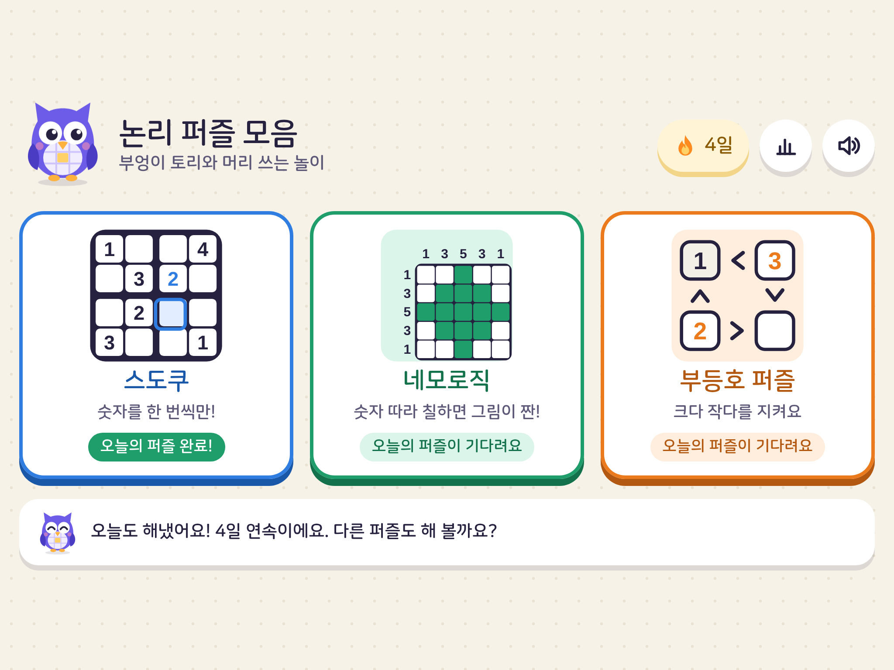
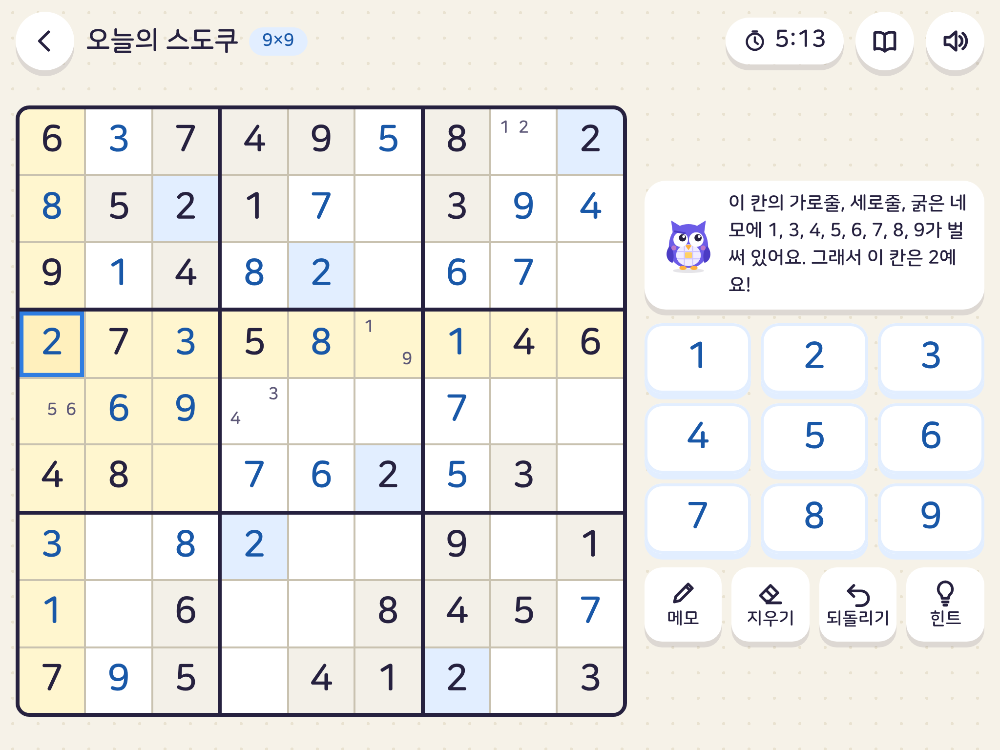
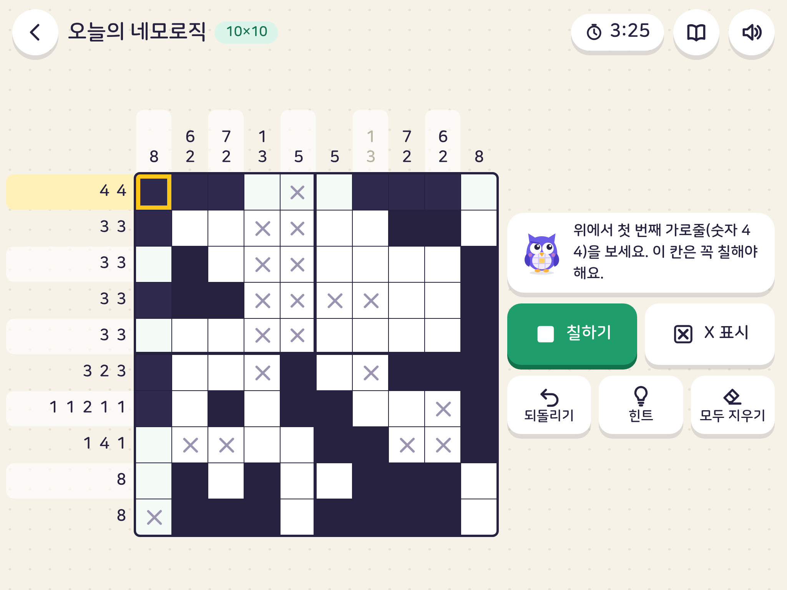
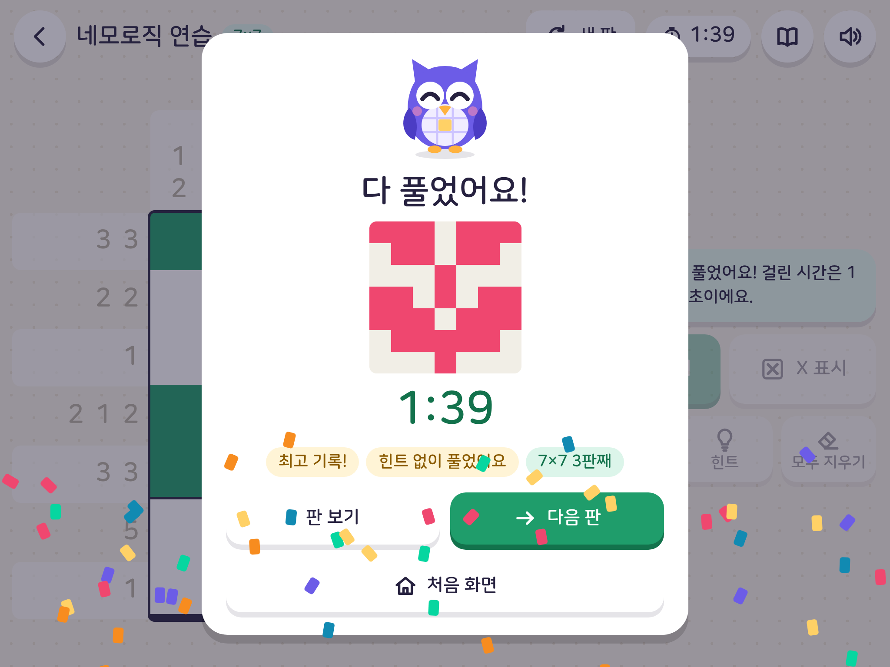

# 논리 퍼즐 모음 🦉

만 10세(초등 4학년 무렵) 아이가 **아이패드에서 손가락으로** 하는 논리 퍼즐 놀이입니다.
보라색 부엉이 **토리**가 길잡이를 해 줍니다.

- **스도쿠** — 4×4 → 6×6 → 9×9
- **네모로직** — 5×5 → 7×7 → 10×10 (다 칠하면 숨은 그림이 나와요)
- **부등호 퍼즐** — 4×4 → 5×5 → 6×6

빌드 없이 도는 정적 사이트(HTML·CSS·자바스크립트 모듈)입니다. 외부 라이브러리·글꼴·CDN을 하나도 쓰지 않아서
**인터넷이 없어도** 동작합니다. 그림(토리, 아이콘, 퍼즐 그림)은 모두 SVG로 직접 그렸습니다.

| 첫 화면 (가로) | 9×9 스도쿠 + 힌트 (가로) |
| --- | --- |
|  |  |
| **네모로직 10×10 (가로)** | **다 풀었을 때 (가로)** |
|  |  |

세로 화면과 나머지 화면은 [`docs/`](docs/) 폴더에 있습니다.

## 켜는 법

### 1) 컴퓨터에서 서버 켜기

```bash
cd logic-puzzles
python3 -m http.server 8000
```

컴퓨터 브라우저로 `http://localhost:8000` 을 열면 바로 놀 수 있습니다.

### 2) 같은 와이파이의 아이패드에서 열기

1. 컴퓨터의 내부 IP 주소를 찾습니다.
   - macOS: `ipconfig getifaddr en0` (또는 시스템 설정 → Wi‑Fi → 세부사항)
   - Windows: `ipconfig` 의 "IPv4 주소"
2. 아이패드 **사파리**에서 `http://<컴퓨터 IP>:8000` 으로 접속합니다. (예: `http://192.168.0.12:8000`)
3. 공유 단추 → **홈 화면에 추가** 를 누르면 앱처럼 전체 화면으로 열립니다.

> **오프라인 캐시 안내**
> 서비스 워커(오프라인 캐시)는 브라우저 규칙상 **https 주소나 localhost에서만** 켜집니다.
> 집 와이파이에서 `http://192.168.x.x` 로 열면 앱은 잘 돌지만 컴퓨터 서버가 켜져 있어야 합니다.
> 인터넷 연결은 필요 없습니다(같은 와이파이 안에서만 주고받습니다).
> 서버 없이도 열리게 하려면 이 폴더를 https 정적 호스팅에 올리면 됩니다. 한 번 열고 나면 비행기 모드에서도 열립니다.

> **소리 안내**
> 음성·효과음은 화면을 한 번 만진 뒤부터 나옵니다(사파리 자동 재생 규칙).
> 한국어 음성이 안 나오면 아이패드 설정 → 손쉬운 사용 → 읽기 및 말하기 → 음성 에서 한국어 음성이 있는지 확인해 주세요.
> 음성 안내는 윗줄의 스피커 단추나 **내 기록 → 설정** 에서 끌 수 있습니다.

## 놀이 방법

### 오늘의 퍼즐과 연습

- **오늘의 퍼즐**: 날짜를 씨앗으로 만든 판이라 **같은 날에는 누가 열어도 같은 판**이 나옵니다(퍼즐·단계마다 하나씩).
  다음 날이 되면 새 판이 나옵니다.
- **연습하기**: 단계를 골라 새 판을 끝없이 풀 수 있습니다.
- **단계**: 앞 단계를 **2판** 풀면 다음 단계가 열립니다(4×4를 2판 → 6×6 열림).
- **연속 기록**: 오늘의 퍼즐을 하나라도 푼 날이 며칠째 이어지는지 셉니다. 연습 판은 연속 기록에는 들어가지 않습니다
  (푼 판 수와 최고 기록에는 들어갑니다).

### 도구

| 단추 | 하는 일 |
| --- | --- |
| 💡 **힌트** | 틀린 칸이 있으면 먼저 그 칸을 흔들어 알려 줍니다. 틀린 칸이 없으면 **지금 논리로 알 수 있는 칸 하나**를 채우고 이유를 말해 줍니다. (예: "이 칸의 가로줄, 세로줄, 굵은 네모에 1, 2, 4가 벌써 있어요. 그래서 이 칸은 3이에요!") |
| ↶ **되돌리기** | 바로 앞 동작을 되돌립니다. 네모로직은 손가락으로 쭉 민 한 번이 한 동작입니다. |
| ✏️ **메모** | (스도쿠·부등호) 켜면 숫자가 작은 글씨 후보로 적힙니다. 숫자를 넣으면 같은 줄의 메모에서 그 숫자가 저절로 지워집니다. |
| ⏱ **시간** | 푸는 동안 시간이 흐르고, 다른 앱으로 가거나 규칙을 볼 때는 멈춥니다. 퍼즐·단계마다 가장 빠른 기록이 남습니다. |
| 📖 **규칙** | 언제든 규칙을 다시 볼 수 있습니다. "읽어 주세요"를 누르면 소리 내어 읽어 줍니다. |

하던 판은 저절로 저장되어, 앱을 닫았다 열어도 이어서 할 수 있습니다.

## 퍼즐 규칙

### 스도쿠
1. 가로줄 하나에 1부터 N까지(4×4면 1~4) 숫자가 한 번씩 들어갑니다.
2. 세로줄 하나에도 한 번씩 들어갑니다.
3. 굵은 선으로 묶인 네모 안에도 한 번씩 들어갑니다.
4. 빈칸을 모두 채우면 성공! 같은 숫자가 겹치면 빨간 점선 동그라미로 알려 줍니다.

조작: 빈칸을 누르고 → 숫자 단추를 누릅니다. 같은 숫자를 다시 누르면 지워집니다.

### 네모로직
1. 줄 옆(가로줄)과 위(세로줄)의 숫자는 그 줄에서 **이어서 칠해야 하는 칸의 수**입니다.
2. 숫자가 여러 개면 그 순서대로 칠하고, 묶음과 묶음 사이에는 빈칸이 한 칸 이상 있습니다.
   예: `2 1` → ■■□■□ 처럼.
3. 모든 줄이 숫자와 맞으면 숨은 그림이 색깔로 나타납니다. 다 맞은 줄의 숫자는 흐려집니다.

조작: 칸을 누르면 칠해지고, **손가락으로 쭉 밀면** 한 줄을 이어서 칠합니다(손이 살짝 비뚤어져도 처음 방향의 한 줄만 칠해요).
**X 표시** 모드로 바꾸면 비워 둘 칸에 X를 쳐 둘 수 있습니다. 5칸마다 굵은 선이 있어 세기 쉽습니다.

### 부등호 퍼즐
1. 가로줄 하나에 1부터 N까지 숫자가 한 번씩 들어갑니다.
2. 세로줄 하나에도 한 번씩 들어갑니다.
3. 칸 사이 부등호(`<`, `>`)를 꼭 지킵니다. **벌어진 쪽이 큰 수, 뾰족한 쪽이 작은 수**입니다.
4. 위아래 칸 사이의 `∧`, `∨` 도 똑같습니다(뾰족한 쪽이 작은 수). 어긴 부등호는 빨갛게 보입니다.

### 세 번째 퍼즐로 '부등호 퍼즐'을 고른 이유

부등호 퍼즐(일본 이름 Futoshiki, '부등호'라는 뜻의 일반 명사)은 여러 퍼즐 책·앱에서 두루 쓰는 일반 형식입니다.

- **규칙이 짧습니다.** "줄마다 한 번씩 + 부등호를 지킨다" 두 가지뿐이라 만 10세가 바로 시작할 수 있습니다.
- **학교 수학과 이어집니다.** 학교에서 배운 `>`, `<` 를 퍼즐로 다시 쓰고, "이 칸은 옆 칸보다 커야 하니 1은 안 돼" 같은
  **연쇄 추론**(조건이 이어지는 생각)을 자연스럽게 연습합니다.
- **스도쿠와 다른 생각을 씁니다.** 스도쿠가 '빠진 숫자 찾기'라면, 부등호는 '크기 비교로 후보 줄이기'입니다.
- **손가락 조작을 새로 배울 필요가 없습니다.** 스도쿠와 같은 "칸 누르고 숫자 누르기"라서 아이패드에서 편합니다.
- **4×4 → 5×5 → 6×6** 으로 난이도를 고르게 올릴 수 있고, 판이 작아 아이패드 세로·가로 모두 글자가 큼직합니다.
- 해가 하나뿐인지 컴퓨터로 확실히 시험할 수 있습니다(아래 '시험' 참고).

(다른 후보였던 카쿠로는 덧셈 조합이 많아 아이에게 무겁고, 하시·별 배치 같은 퍼즐은 해가 하나뿐인 판을 안정적으로 만들기 어렵다고 보았습니다.)

## 판을 만드는 방법

- **씨앗 난수**: `js/core/rng.js` — 문자열 씨앗(`daily|2026-10-30|sudoku|4`)을 해시해서 정수 연산만 쓰는 난수 생성기(sfc32)를 돌립니다.
  그래서 아이패드 사파리와 컴퓨터 크롬에서 같은 날 같은 판이 나옵니다. 연습 판은 `practice|퍼즐|단계|번호` 씨앗을 씁니다.
- **스도쿠** (`js/core/sudoku.js`): 무작위로 꽉 찬 정답을 만든 뒤, 점대칭으로 두 칸씩 지웁니다.
  **"여기엔 이 숫자뿐" + "이 숫자는 여기뿐" 두 방법만으로 끝까지 풀리는 동안만** 지웁니다.
  → 해가 하나뿐이고, 추측 없이 논리만으로 풀립니다. 처음 숫자: 4×4는 6개, 6×6은 14개, 9×9는 32~33개.
- **부등호** (`js/core/futoshiki.js`): 무작위 라틴 방진에서 시작해 숫자와 부등호를 하나씩 빼 보되,
  "줄 규칙 + 부등호로 후보 줄이기"만으로 풀리는 동안만 뺍니다.
  보통 4×4는 숫자 2개·부등호 7개, 5×5는 숫자 3개·부등호 10개, 6×6은 숫자 4개·부등호 14개쯤 남습니다.
- **네모로직** (`js/core/nonogram.js`): 무작위 그림(10×10은 한 번 부드럽게 다듬고 절반은 좌우 대칭)을 만든 뒤,
  **한 줄씩만 보고 푸는 방법(줄 풀기)** 으로 끝까지 풀리는지 봅니다. 막히면 막힌 칸 하나를 뒤집어 고칩니다.
  → 해가 하나뿐이고, 줄 하나만 보고 차근차근 풀 수 있습니다. 빈 줄은 나오지 않습니다.
- 힌트도 같은 논리 풀이기를 써서 "지금 알 수 있는 칸"을 고르고 이유를 만듭니다.

## 시험

시험 도구(Playwright)는 이 폴더의 `package.json` devDependencies에만 있습니다.

```bash
cd logic-puzzles
npm install
```

```bash
npm test
```

```bash
npm run test:e2e
```

- `npm test` (Node 내장 시험, 약 10초)
  - `tests/unit/uniqueness.test.js` — 퍼즐 3종 × 단계 3개 = 9개 단계마다 **300판**씩 만들어,
    앱 코드와 **따로 짠 풀이기**(`tests/helpers/reference-solvers.js`)로 **해가 정확히 하나**인지, 그 해가 생성기 정답과 같은지 셉니다.
    판 수는 `BOARDS=1000 npm test` 처럼 늘릴 수 있습니다.
  - `tests/unit/daily.test.js` — 같은 날짜 씨앗이면 같은 판, 30일 동안 날짜마다 다른 판, 오늘의 판 지문 고정.
  - `tests/unit/check.test.js` — 정답 판정(완성·빈칸·겹침·처음 숫자 바꿈·부등호 어김·X표는 빈칸으로 침·줄별 완성 표시).
  - `tests/unit/solvers.test.js` — 줄 풀기 단위 시험, 논리만으로 풀리는지, **힌트만 계속 눌러도 끝까지 풀리고 힌트가 늘 정답**인지.
  - `tests/unit/records.test.js` — 연속 기록·최고 기록·단계 열림.
  - `tests/unit/static.test.js` — 앱 파일에 바깥 주소(CDN 등)가 없고, `sw.js` 캐시 목록에 빠진 파일이 없는지.
- `npm run test:e2e` (Playwright 크로미엄, 아이패드 사파리 사용자 에이전트 + 터치, 약 15초)
  - **1024×768(가로)·768×1024(세로)** 에서 첫 화면 → 스도쿠 → 오늘의 퍼즐 4×4를 **터치로 끝까지 풀기**.
    화면의 판이 Node에서 같은 씨앗으로 만든 판과 같은지, 칸·단추가 손가락에 넉넉한 크기인지, 기록·연속 기록이 저장되는지도 봅니다.
  - 메모·되돌리기·틀린 칸 힌트·논리 힌트·새로 고침 뒤 이어 하기.
  - 네모로직을 손가락으로 **쭉 밀어** 칠하기(실제 터치 이벤트), 되돌리기 한 번에 한 획, 끝까지 풀어 그림 나오기.
  - 부등호 어기면 빨간 기호, 끝까지 풀기 / 잠긴 단계 막기.
  - 모든 화면에서 바깥 주소 요청이 0개인지, 서비스 워커 캐시 후 **오프라인**에서도 열리는지.

**자동 시험(GitHub Actions)**: 저장소 루트의 `.github/workflows/logic-puzzles.yml` 이
`logic-puzzles/` 가 바뀐 PR과 `main` 에 올린 커밋마다 위 두 시험을 돌립니다(다른 앱 폴더만 바뀌면 돌지 않습니다).
결과는 PR의 Checks 칸과 저장소의 Actions 탭에서 볼 수 있고, Actions 탭에서 "Run workflow"로 손으로 돌릴 수도 있습니다.

스크린샷은 `npm run screenshots` 로 `docs/` 에 다시 찍을 수 있습니다(날짜를 2026-10-30으로 고정해 찍습니다).
앱 아이콘 PNG는 `npm run icons` 로 `icons/icon.svg` 에서 다시 만듭니다.

## 폴더 구조

```
logic-puzzles/
├── index.html            앱 시작 페이지
├── manifest.json         홈 화면 앱 정보 (PWA)
├── sw.js                 오프라인 캐시 (서비스 워커)
├── css/app.css           화면 꾸밈 (가로·세로 모두)
├── icons/                앱 아이콘 (SVG 원본 + PNG)
├── js/core/              퍼즐 두뇌 — 화면과 상관없는 순수 코드 (Node에서 시험)
│   ├── rng.js            씨앗 난수
│   ├── dates.js          날짜 계산
│   ├── sudoku.js         스도쿠 만들기·풀기·판정·힌트
│   ├── nonogram.js       네모로직 만들기·줄 풀기·판정·힌트
│   ├── futoshiki.js      부등호 만들기·풀기·판정·힌트
│   ├── catalog.js        퍼즐·단계 목록, 씨앗 → 판
│   └── records.js        기록·연속 기록·단계 열림 계산
├── js/app/               화면
│   ├── main.js           화면 고르기(첫 화면·퍼즐 고르기·내 기록)
│   ├── game.js           놀이 화면 공통(시간·되돌리기·힌트·저장·축하)
│   ├── number-board.js   스도쿠·부등호 판과 숫자 단추
│   ├── nonogram-board.js 네모로직 판과 손가락 칠하기
│   ├── rules.js          규칙 설명
│   ├── art.js            토리와 그림·아이콘 (SVG)
│   ├── voice.js          음성 안내 (Web Speech, ko-KR)
│   ├── sound.js          효과음 (Web Audio)
│   ├── store.js          localStorage 저장
│   ├── dom.js, fx.js     작은 도우미, 꽃가루
├── tests/                시험 (unit: Node, e2e: Playwright)
├── tools/                아이콘·스크린샷 만드는 도구
└── docs/                 아이패드 크기 스크린샷
```

## 저장

모든 진행·기록은 아이패드의 **localStorage** 한 곳(`logic-puzzles:v1`)에 저장됩니다.
같은 주소에서 도는 다른 앱과 섞이지 않도록 이름 앞에 `logic-puzzles:` 를 붙였고, 서비스 워커도 `logic-puzzles-` 로 시작하는 캐시만 정리합니다.
기록은 **내 기록 → 설정 → 기록을 모두 지우기** 로 지울 수 있습니다.

## 고칠 때 알아 둘 것

- 앱 파일을 고쳐서 다시 올릴 때는 `sw.js` 의 `VERSION` 을 하나 올려 주세요. 그래야 홈 화면 앱이 새 파일을 받습니다.
- 파일을 더하거나 빼면 `sw.js` 의 `ASSETS` 목록도 고쳐야 합니다(빠지면 `npm test` 가 알려 줍니다).
- 생성기를 고치면 같은 날짜의 판이 바뀝니다. 일부러 바꾼 것이면 `tests/unit/daily.test.js` 의 지문 값을 새로 적어 주세요.
- 단계를 여는 데 필요한 판 수는 `js/core/catalog.js` 의 `UNLOCK_AFTER`, 처음 숫자·부등호 개수도 같은 파일에서 바꿀 수 있습니다.
